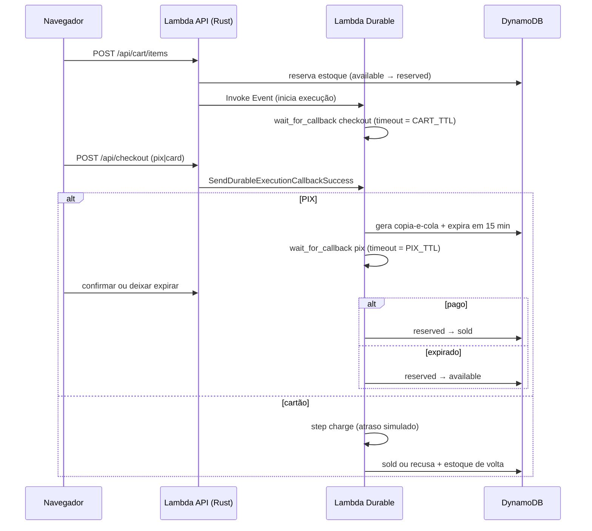

# Arena Store — AWS Lambda Durable Functions (Rust)

Projeto **de teste / demo pública**. Uma loja virtual fictícia de artigos esportivos que usa [AWS Lambda Durable Functions](https://docs.aws.amazon.com/lambda/latest/dg/durable-functions.html) em Rust para orquestrar o **carrinho** (reserva de estoque + expiração) e o **pagamento** (PIX com QR de 15 minutos ou cartão de teste com atraso da operadora).

É o irmão do demo em Go (`aws-lambda-durable-function-go`), portado para o [SDK oficial de Durable Execution em Rust](https://github.com/aws/aws-durable-execution-sdk-rust) (`aws-durable-execution-sdk` 1.0.0).

Não é um produto real. Não processa pagamento de verdade. Não deve ir para produção com dados de clientes.

## O que este repositório demonstra

Cliente abre o site → escolhe produtos → reserva unidades no carrinho → entra como visitante fictício → checkout com **PIX** ou **cartão** → a função durable checkpointa cada passo, suspende enquanto espera (sem cobrar compute no wait) e devolve o estoque se o carrinho ou o PIX expirar.



Stack:

| Camada | Tecnologia |
| --- | --- |
| Backend | Rust 1.94+, [`aws-durable-execution-sdk`](https://github.com/aws/aws-durable-execution-sdk-rust) |
| API HTTP | Lambda `provided.al2023` arm64 + API Gateway HTTP API + Axum |
| Orquestração | Lambda Durable Function (`ctx.wait_for_callback`, `ctx.step`) |
| Banco | DynamoDB (uma tabela, on-demand) |
| Frontend | Vite + React, hospedado no S3 + CloudFront |
| Infra | OpenTofu (`hashicorp/aws` ≥ 6.25, por causa de `durable_config`) |

O prefixo padrão dos recursos é `arena-rust` para não colidir com o stack Go (`arena-store`).

## Fluxo da loja

1. Catálogo com ~24 itens (futebol, basquete, vôlei, tênis, luta, corrida, etc.).
2. Login **sempre cria um usuário fictício único** (`visitante.<id>@arena-demo.local`). Sem senha.
3. Adicionar ao carrinho **reserva** quantidade. O estoque livre cai na hora.
4. A sessão durable fica aberta até o checkout **ou** até `CART_TTL` (padrão 15 min). Se expirar, as unidades voltam.
5. **PIX**: QR EMV (copia e cola) com 15 min. Confirme na tela da demo ou deixe expirar.
6. **Cartão de teste**
   - Aprovado: `1111111111111111` / `01/2040` / `111`
   - Recusado: `0000000000000000` / `01/2040` / `111`
   - Opcional: simular atraso extra da operadora ou recusa.
7. Pedido, carrinho e produto mostram status ao vivo (o frontend faz poll).

## Rodar local (sem AWS)

Requisitos: Rust 1.94+ (`cargo-lambda` só é necessário para o zip de deploy), Node 20+.

```bash
make test          # testes do workflow durable, estoque e PIX
make local         # API em 127.0.0.1:8080 (memória + LocalRunner)
make frontend-dev  # Vite em 5173, proxy /api → 8080
```

O modo local usa o `LocalRunner` oficial do SDK (o mesmo das unit tests) e um relógio de parede para expirar carrinho/PIX. Timeouts:

```bash
CART_TTL_SECONDS=60 PIX_TTL_SECONDS=45 CARD_DELAY_SECONDS=2 make local
```

## Deploy na AWS

Durable functions **só podem ser habilitadas na criação** da função (`durable_config`). O deploy usa a região **`us-east-2`** por padrão. Confira a [disponibilidade por região](https://aws.amazon.com/about-aws/whats-new/2026/04/lambda-durable-functions-16-new-regions/).

Credenciais ficam na máquina (`AWS_PROFILE`, variáveis de ambiente ou `~/.aws`). **Nada de access key no repositório.**

```bash
aws sts get-caller-identity
make deploy          # testa, binaries Linux/arm64, tofu apply, sync S3
```

OpenTofu sobe DynamoDB, duas Lambdas (API + durable com alias `live`), HTTP API, S3 privado e CloudFront. O site usa o mesmo domínio do CloudFront: `/` é o React, `/api/*` vai para a API.

Para TTLs curtos na AWS (teste de expiração sem esperar 15 min), copie `infra/terraform.tfvars.example` para `infra/terraform.tfvars` — esse arquivo está no `.gitignore`.

## Testes

Os testes **não** chamam a AWS. O `LocalRunner` do SDK replica o loop de replay da Lambda:

- PIX pago → `reserved` vira `sold`
- PIX expirado → estoque restaurado
- Carrinho expirado → estoque restaurado
- Cartão aprovado / recusado

```bash
cd backend && cargo test
```

## Segurança (auditoria do que entra no GitHub público)

Este repo é um **sandbox**. Mesmo assim:

- `.gitignore` cobre `.env`, `*.tfvars`, `*.tfstate`, zips, `bootstrap`, `target/`, credenciais.
- Nenhum secret hardcoded. Cartão de teste é dado público de demo, igual a um sandbox de gateway.
- PAN do cartão **não é persistido**. Só os últimos 4 dígitos depois da aprovação.
- Callback IDs das durable executions não vão para o JSON do frontend.
- S3 do site é privado; só o CloudFront (OAC) lê.
- IAM da API: DynamoDB da tabela + `InvokeFunction` / callbacks na função durable. A durable: logs + `AWSLambdaBasicDurableExecutionRolePolicy` + DynamoDB.
- CORS aberto (`*`) de propósito: é uma demo. O caminho feliz é same-origin no CloudFront.
- Usuários “visitante” não têm senha. O token de sessão é um id aleatório de 128 bits, não um JWT com chave no código.

O que **não** fazer: commitar `infra/terraform.tfstate`, colar `AWS_SECRET_ACCESS_KEY` no README, ligar o bucket como website público, ou reutilizar este checkout em uma loja de verdade.

## Layout

```
backend/          # crate Rust (bins api + durable)
frontend/         # Vite + React
infra/            # OpenTofu
docs/instructions.md
```

## Próximo passo (depois do deploy)

Simular dois navegadores: um paga no PIX a tempo, outro deixa expirar, um terceiro usa o cartão de teste com atraso. Conferir estoque na tela do produto (`disponíveis` / `reservados` / `vendidos`) e a linha do tempo do pedido — cada evento veio de um `ctx.step` ou de um callback retomado.
